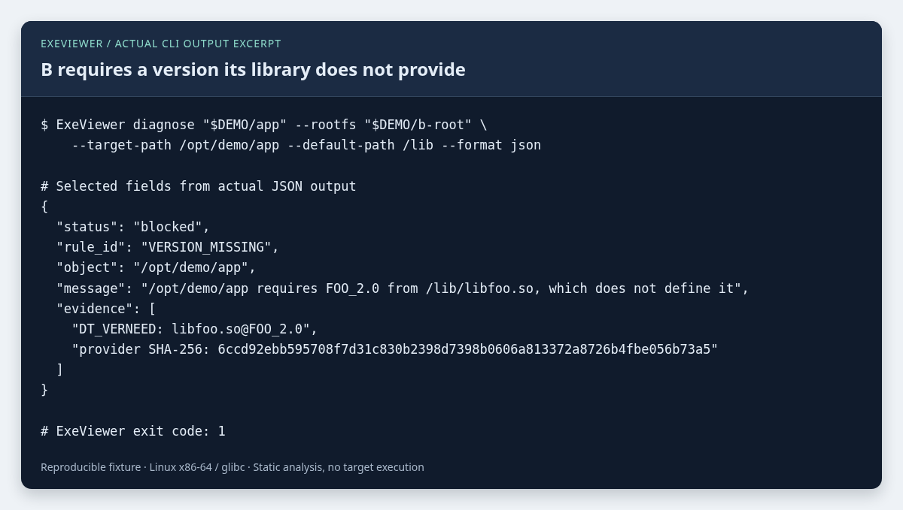
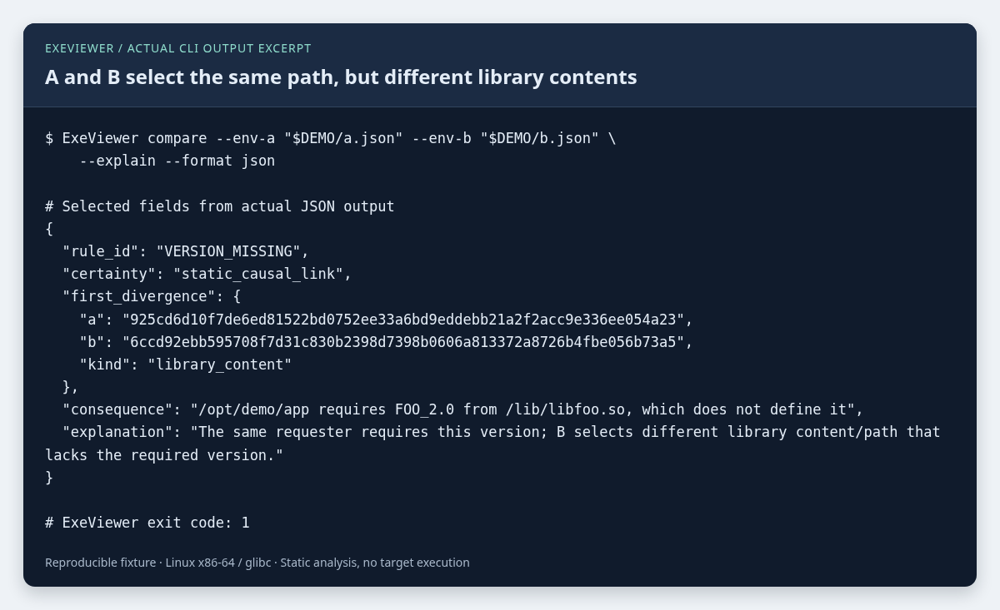
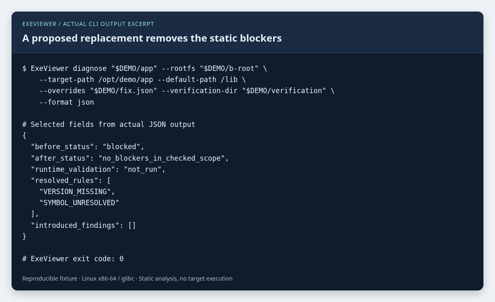
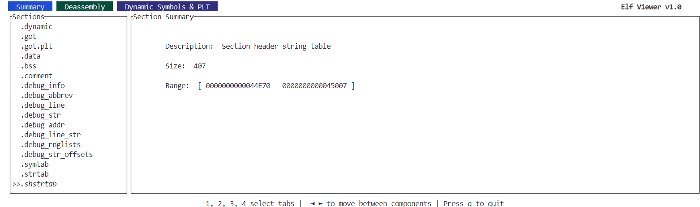
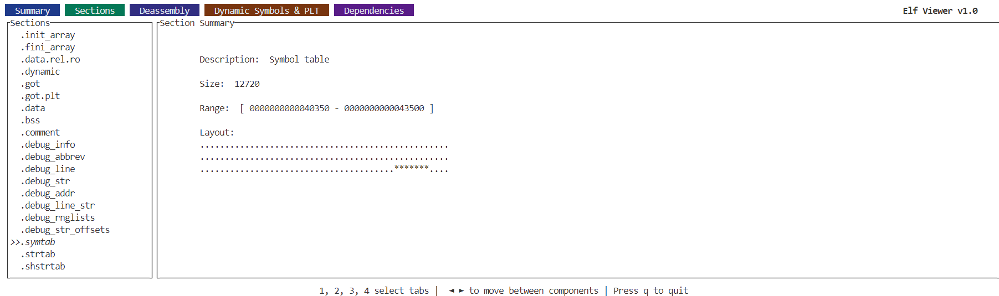
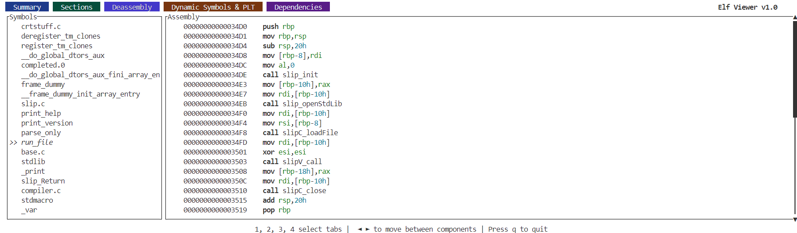
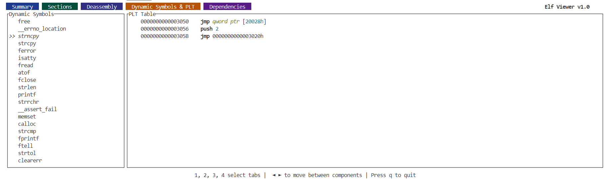
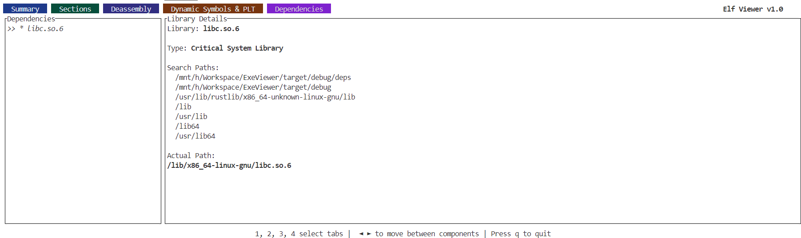

# ExeViewer

**Explain why a Linux executable or shared library built in one environment fails in another.**

ExeViewer helps Linux developers follow the evidence from ELF requirements to library
searches, selected dependencies, symbol providers, and compatibility failures. It offers
non-interactive text/JSON commands and an optional terminal interface.

- Which shared libraries does this program need, including indirect dependencies?
- Which paths were searched, and why was a particular library selected?
- What changed between A and B: search configuration, library contents, or symbol versions?
- Does a proposed library/path change remove the diagnosed blockers or introduce new ones?

**Current scope:** Linux ELF64 little-endian, x86-64, glibc startup analysis. Unsupported
rules and insufficient evidence are reported as **incomplete**, not as compatibility.
Static checks do not prove successful execution or full ABI compatibility.

> Development status: the workflow below is implemented in the review branches for
> [#4](https://github.com/sunxfancy/ExeViewer/pull/4),
> [#5](https://github.com/sunxfancy/ExeViewer/pull/5),
> [#6](https://github.com/sunxfancy/ExeViewer/pull/6), and
> [#7](https://github.com/sunxfancy/ExeViewer/pull/7), on top of
> [#3](https://github.com/sunxfancy/ExeViewer/pull/3). The default branch may not yet
> contain these commands. Installation below selects the complete demo branch.

## See the diagnosis workflow

This reproducible example uses the **same executable** in both environments. It requires
`FOO_2.0`; A supplies it, while B has an older `libfoo.so` providing only `FOO_1.0`.

### 1. Identify B's blocker

The report identifies the requester, selected library, missing version, and supporting evidence.



### 2. Explain the A/B difference

The library path is identical in A and B. Its contents differ. The comparison connects
that change to the unchanged executable's version requirement.



### 3. Verify a proposed repair

A replacement is copied into a separate verification directory and used for static
simulation. The original B rootfs remains unchanged. The report distinguishes removed
findings, new findings, and the fact that the program **has not been run**.



These images are screenshots of **selected fields from actual JSON output**, formatted
for readability—not a new graphical interface. [Text transcripts](docs/demo/transcripts/)
and the [reproduction instructions](docs/demo/README.md) are included.

## Install and try it

Requires Rust/Cargo. The demo also requires Linux x86-64, GCC, Python 3, and glibc.
The binary is named **`ExeViewer`** (case-sensitive).

```sh
git clone --branch docs/diagnostic-workflow-demo https://github.com/sunxfancy/ExeViewer.git
cd ExeViewer
cargo install --path . --locked

# Inspect this machine's /bin/ls without running it
ExeViewer diagnose /bin/ls

# Build the fixtures and reproduce all three demo results
# Choose a work directory that does not already exist.
python3 docs/demo/run.py --binary "$(command -v ExeViewer)" \
  --work-dir /tmp/exeviewer-demo
```

For a local development build, use `cargo build --locked`; the binary is
`target/debug/ExeViewer`. Image generation is optional and documented separately.

## Commands at a glance

| Command | What it answers |
| --- | --- |
| `inspect FILE` | What metadata, dependencies, symbols, and versions does this ELF declare? |
| `diagnose FILE` | What does the supported startup model resolve, and which requirements fail? |
| `env capture FILE --output env.json` | Which environment inputs and file evidence should be preserved for this artifact? |
| `compare --env-a a.json --env-b b.json --explain` | Which recorded differences explain new failures? |
| `trace --log loader.log --baseline report.json` | How do observed loads and symbol bindings compare with predictions? |
| `trace --execute FILE --output-dir NEWDIR` | What happens on an explicitly requested local execution? |
| `diagnose FILE --overrides fix.json --verification-dir NEWDIR` | What changes when a proposed repair is simulated? |

Diagnostic commands default to plain text and support `--format json` without a TTY.
JSON includes a schema version and distinguishes static predictions, runtime observations,
and unknowns. Only **`trace --execute`** runs the target; it is not a sandbox.

## Analyze a target environment

Capture evidence **on B** for the exact executable you want to investigate:

```sh
ExeViewer env capture /opt/app/app --output b-env.json --format json
```

Transfer the executable, manifest, and a separately obtained target rootfs to the
development machine. A manifest is an artifact-specific evidence inventory, **not a
rootfs archive**. Default loader directories are conventional assumptions unless explicitly
supplied with `--default-path`; see the [environment contract](docs/cli.md).

```sh
ExeViewer diagnose ./app --env b-env.json --rootfs ./b-rootfs \
  --format json > b.json

# a.json must describe the same input executable (same SHA-256).
ExeViewer compare --env-a a.json --env-b b.json --explain --format json
```

Import validates recorded file hashes, link destinations, and missing search candidates.
Changed evidence requires a fresh capture. Offline resolution does not fill missing target
libraries from the host. Reports retain unresolved and unsupported cases.

## Simulate a repair, then collect runtime evidence

An example `fix.json`:

```json
{
  "schema_version": 1,
  "kind": "diagnosis_overrides",
  "replacements": [
    {"target": "/opt/app/lib/libfoo.so", "source": "./candidate/libfoo.so"}
  ]
}
```

The target is the library's path inside the target filesystem. Source paths are relative
to the configuration file. Use a library compatible with the application's actual ABI;
a matching filename or symbol alone is not sufficient.

```sh
ExeViewer diagnose ./app --env b-env.json --rootfs ./b-rootfs \
  --overrides fix.json --verification-dir ./verification-001 --format json
```

The new directory retains `before.json`, `after.json`, `verification.json`, replacement
copies, and a replayable `overrides.json`. It does not deploy the repair. After deploying
and testing a candidate in the real target environment, explicitly collect runtime evidence:

```sh
ExeViewer trace --execute /opt/app/app --output-dir ./capture-001 \
  --baseline ./verification-001/after.json --format json -- --application-argument
```

Tracing runs locally, not inside `--rootfs`. It captures target stdout/stderr separately
from the report. A successful trace covers only the exercised execution path.

## Results and boundaries

For `diagnose` and static repair verification:

| Exit code | Meaning |
| --- | --- |
| `0` | No blockers in the checked scope—not a general compatibility guarantee. |
| `1` | Blockers found, with no incomplete checks. |
| `2` | Incomplete/unsupported analysis or an input error. Known blockers are still retained. |

`compare`, `trace`, and `inspect` have their own [documented exit-code contracts](docs/cli.md).

Supported analysis includes recursive startup dependencies, search attempts, RPATH/RUNPATH,
supported glibc cache entries, symbol/version requirements, modeled symbol provider order,
and declared GNU CPU/kernel requirements. Root-cause explanations preserve both sides' evidence;
ambiguous cases remain unexplained.

Full plugin/`dlopen` scopes, separate namespaces, IFUNC implementation selection, deep C++ ABI,
actual instruction/system-call requirements, musl, and other architectures remain outside
this release's scope. A standalone `.so` lacks a definitive executable host scope.

## Interactive ELF inspection

```sh
ExeViewer diagnose ./app --interactive  # Four diagnosis pages; requires a terminal
ExeViewer --interactive ./app           # Original ELF/section/disassembly viewer
ExeViewer --report ./app                # Lightweight metadata inventory
```

The existing interactive viewer remains available alongside the new diagnosis workflow.
It provides ELF metadata, section headers, dynamic symbols, PLT information, and
text-section disassembly. These inspection features have not been removed.
Metadata inspection alone does not assess compatibility.

The original screenshots below show the ELF inspection interface:







## Documentation and validation

- [CLI guide: arguments, JSON, evidence and limitations](docs/cli.md)
- [Product design and scope](docs/product-design.md)
- [Reproduce the demo and screenshots](docs/demo/README.md)

Run `cargo test --locked`. Linux diagnostic fixtures need GCC, Python 3, and glibc;
they compare representative cases against the real loader. The CI workflow targets
Ubuntu 22.04 and 24.04; consult individual PR checks for actual results.

## License

MIT License (c) 2024 sunxfancy
